

  

  
  
  

## Live products

Things you can open right now. The green dot is a live site.

<table>
<tr>
<td><a href="https://vapsi.pages.dev">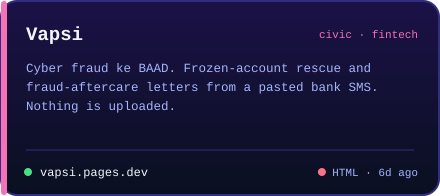</a></td>
<td><a href="https://matchfix.pages.dev">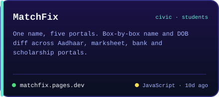</a></td>
</tr>
<tr>
<td><a href="https://360playzone.com">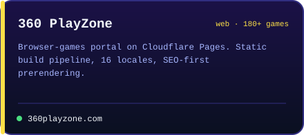</a></td>
<td><a href="https://github.com/Anki1004/powerbi-data-jobs-market">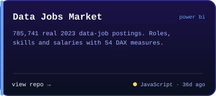</a></td>
</tr>
<tr>
<td><a href="https://github.com/Anki1004/powerbi-upi-pulse">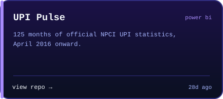</a></td>
<td><a href="https://github.com/Anki1004/powerbi-ai-race">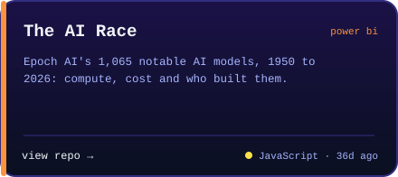</a></td>
</tr>
</table>

## The city I built this year


## Commit heartbeat


## Space shooter

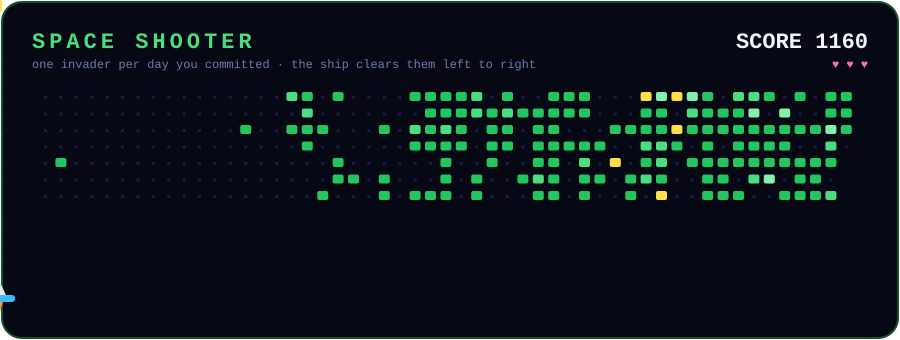

## Stack

<table>
<tr>
<td valign="top"></td>
<td valign="top">

**Data** &nbsp; Power BI · DAX · SQL · Python · pandas · Excel 
**Web** &nbsp; JavaScript · TypeScript · React · Next.js · Cloudflare Pages · Vercel 
**How I work** &nbsp; measure first, build it, test it in a real browser, then write down what the numbers actually said.

Open to freelance work, internships and open-source collaboration. Email is the fastest way in.

</td>
</tr>
</table>

Every picture above is generated from the public GitHub API and contribution calendar by `scripts/build-all.mjs`, refreshed daily by a workflow in this repo. No third-party stats service is involved.
